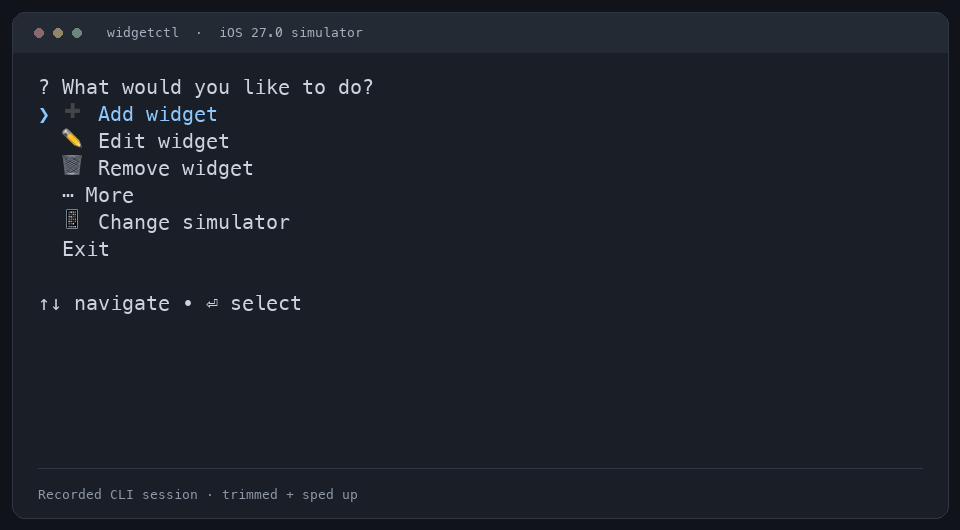

# widgetctl

**Set up iOS Simulator widgets without clicking through the widget gallery.**

Pick an app, widget and size in your terminal. Edit its settings, reproduce a test setup, or automate it from TypeScript and Playwright.

- 🎯 Pick installed apps, widgets and sizes in the terminal
- ⚙️ Edit typed widget settings before saving
- 🤖 Automate with explicit arguments and JSON output
- 🧪 Use TypeScript and Playwright fixtures
- 💾 Export and restore exact saved configuration

[](https://github.com/DimaMishchenko/widgetctl/actions/workflows/test.yml) [](LICENSE)

## Install

Requires **macOS, Node 22.14+ and full Xcode**. Install your app on a simulator and open it once so its widgets can register.

Install in your project:

```sh
npm install --save-dev widgetctl
```

Or install globally and run it anywhere:

```sh
npm install --global widgetctl
widgetctl
```

For reproducible installs, use `widgetctl@0.1.1` and keep your lockfile. [Distribution and releases →](docs/distribution.md)

## Agent skill and plugins

The plugin includes the CLI. Agents can use it immediately without a separate npm installation.

The short [widgetctl skill](skills/widgetctl/SKILL.md) teaches agents when to use the tool, JSON discovery, safe configuration edits and simulator ownership.

Add this repository as a Codex marketplace:

```sh
codex plugin marketplace add DimaMishchenko/widgetctl
```

Then install **widgetctl** from that marketplace in the desktop Plugins directory. The plugin includes the CLI and its dependencies. [Codex, Claude Code and standalone skill setup →](docs/agents.md)

## CLI

```sh
npx widgetctl
```

Use `npx widgetctl` for a project install, or `widgetctl` for a global install. Choose your simulator, then **Add widget** or **Edit widget**. The pickers show installed apps, widget names and supported sizes. Settings stay in a draft until you choose **Save changes**. **More** holds details, import/export and diagnostics.

For scripts and agents, use explicit arguments and `--json`:

```sh
npx widgetctl devices --json
npx widgetctl catalog --device "$SIMULATOR_UDID" --json
npx widgetctl add --device "$SIMULATOR_UDID" \
  --app com.example.weather --kind Forecast --size medium --json
```

Set `SIMULATOR_UDID` to your reserved, booted simulator and replace the example app/kind with values from `catalog`. JSON mode never prompts. [CLI and configuration guide →](docs/usage.md)

## TypeScript

Use identifiers from your app’s catalog:

```ts
import { createWidgetController } from "widgetctl";

const widgets = createWidgetController({ udid: process.env.SIMULATOR_UDID! });
try {
  await widgets.prepare();
  const widget = await widgets.ensure({
    extension: "com.example.weather.widgets",
    kind: "Forecast",
    size: "medium",
  });
  console.log(widget.iconIdentifier);
} finally {
  await widgets.release();
}
```

`ensure` reuses a matching widget. Handles can export, describe and apply supported configurations, or remove that exact widget. [API examples →](examples/README.md)

## Playwright

Install both packages in your test project:

```sh
npm install --save-dev widgetctl @playwright/test
```

`widgetctl/playwright` is an import subpath exported by `widgetctl`, not a separate npm dependency. The fixture prepares and releases widgetctl for you.

```ts
import { test, expect } from "widgetctl/playwright";

test("forecast widget is configured", async ({ widgets }) => {
  const widget = await widgets.ensure({
    extension: "com.example.weather.widgets",
    kind: "Forecast",
    size: "medium",
  });
  const settings = await widget.exportConfiguration();
  const applied = await widget.applyConfiguration(settings);
  expect(await widget.exportConfiguration()).toEqual(applied);
});
```

Set `workers: 1` and `use.widgetctlOptions.udid` in your [Playwright config](examples/playwright/playwright.config.ts). This checks saved configuration; use a native UI driver to assert rendered content. A browser `page` cannot control the Home Screen.

## Support

Experimental; uses Apple private APIs. Live coverage includes arm64 iPhone simulators on **iOS 26.0, 27.0 and Duo 27.1**. Other runtimes, iPad and Intel are unverified. Physical devices, stacks and Lock Screen widgets are unsupported.

Reserve one simulator per worker. Preparation and release may restart its Home Screen. Always release in `finally`, and connect native UI drivers after preparation.

[Usage](docs/usage.md) · [Examples](examples/README.md) · [Troubleshooting](docs/errors.md) · [Compatibility](docs/compatibility.md) · [Performance](docs/performance.md) · [Releases](docs/distribution.md#publish-a-new-version) · [Privacy](docs/privacy.md) · [Contributing](CONTRIBUTING.md)
